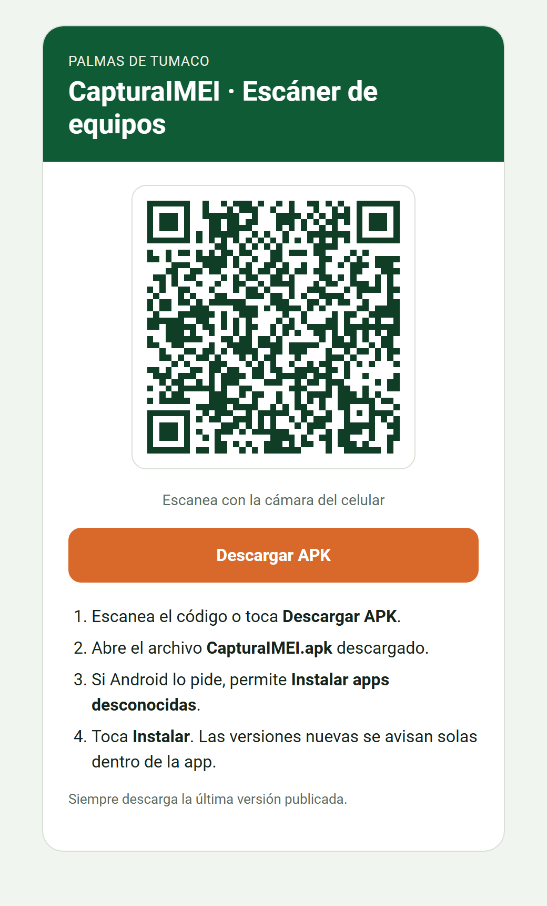

# CapturaIMEI · Palmas de Tumaco

Asignación de celulares a trabajadores de campo: APK Android + página web + base de datos.

## Qué hay en cada carpeta

| Ubicación | Qué es |
|---|---|
| `index.html` y `config.js` (raíz) | Página web (dashboard). GitHub Pages la publica gratis. |
| `apk/` | Aplicación Android. GitHub la convierte en un archivo `.apk` automáticamente. |
| `firebase/` | Reglas y datos iniciales de la base de datos (se usan solo en la etapa 3). |
| `.github/workflows/build-apk.yml` | Las instrucciones que GitHub sigue para construir el APK. |

## Descargar la APK (código QR)

- Enlace fijo, siempre a la última versión: https://github.com/jrodriguezc4/CapturaIMEI/releases/latest/download/CapturaIMEI.apk
- Página para compartir con el QR: https://jrodriguezc4.github.io/CapturaIMEI/descargar.html

## Versiones automáticas
- Cada cambio en la carpeta `apk/` que llega a `main` construye un APK nuevo y lo publica en **Releases** como `v1.0.N` (N sube solo).
- La APK muestra su versión (abajo en el ingreso y arriba junto al nombre) y, con internet, revisa si hay una más nueva: aparece una franja naranja **"Versión nueva disponible"**; al tocarla se descarga e instala encima, sin perder datos.
- Todos los APK se firman con la misma llave (secreto `ANDROID_DEBUG_KEYSTORE` del repositorio; copia de respaldo en `Documentos\CapturaIMEI-firma`, que **no** se sube a GitHub). Si esa llave cambia, hay que desinstalar la app una vez.
- Diseños de las mejoras (ya aplicadas en la APK): [`docs/mejoras-futuras.png`](docs/mejoras-futuras.png).

## Funciones de la APK (versión con mejoras)
- **Resumen de hoy**: al entrar se ven los equipos asignados hoy, los pendientes por enviar, los equipos en campo, los que están en bodega y el reparto por labor.
- **Lote**: *Agregar al lote* (equipo por equipo) o *Escanear varios* (la cámara se vuelve a abrir sola después de cada IMEI; se termina con Atrás). Luego *Asignar los N equipos* a un trabajador o *Devolver a bodega*.
- **Firma y acta**: al asignar, se marcan los adicionales que recibe y el trabajador firma con el dedo. Se genera el acta PDF en el celular (sin internet) y se comparte por WhatsApp o correo. La firma también aparece en el acta que se descarga desde la web.
- **Estado del equipo**: *Reportar devolución, daño o pérdida*, con observación y foto de evidencia. Devuelto y Perdido dejan el equipo sin trabajador; Dañado lo deja asignado pero marcado. La ficha muestra la línea de tiempo del equipo y avisa si el trabajador ya tiene otro equipo.

## Etapa 1: el APK en el celular (modo demo)
1. Pestaña **Actions** → **Construir APK** → espera el círculo verde (unos 8 minutos).
2. Entra a esa ejecución → al final, en **Artifacts**, descarga **CapturaIMEI-apk**.
3. Descomprime el zip: adentro está `app-debug.apk`. Pásalo al celular (WhatsApp, Drive o cable).
4. Ábrelo en el celular y acepta "Instalar apps de origen desconocido". Código de ingreso demo: `4521`.

## Etapa 2: la página web (modo demo)
**Settings → Pages → Source: Deploy from a branch → main / (root) → Save.**
En 1 o 2 minutos queda en `https://TU-USUARIO.github.io/CapturaIMEI/`. Usuario demo `jrodriguezc`, código `Palmas2026`.

## Etapa 3: versión oficial (datos reales y sincronización)
1. Crea el proyecto en https://console.firebase.google.com
2. **Authentication → Método de acceso → Anónimo → Habilitar.**
3. **Realtime Database → Crear base de datos** (modo bloqueado).
4. Pestaña **Reglas**: pega `firebase/reglas.json` → **Publicar**.
5. Pestaña **Datos**: ⋮ → **Importar JSON** → `firebase/datos-iniciales.json`.
6. Engranaje → **Configuración del proyecto → Tus apps → Web (</>)**. Copia `apiKey` y `databaseURL`.
7. En GitHub edita (ícono del lápiz) `config.js` y `apk/www/config.js`, pega esos dos valores y guarda (**Commit changes**).
8. GitHub construye un APK nuevo solo (repite la etapa 1 para instalarlo) y la web se actualiza sola.
9. Entra a la web con `jrodriguezc` / `Palmas2026`, cambia ese código y crea los usuarios de campo (códigos de 6 o más caracteres).

Valor del equipo, adicionales y quien entrega en el acta PDF se cambian en `config.js`.

## Cómo funciona la APK (escáner del equipo de trabajo)
- Se ingresa con **usuario y código** (los que crea jrodriguezc en la web, botón Usuarios). El administrador también puede entrar. Arriba aparece el nombre de quien está usando el escáner.
- **1. Escanear equipo**: *Foto de la etiqueta* lee de una vez los códigos de barras de la caja o etiqueta (IMEI 1, IMEI 2 y SN). También se puede escanear cada código con el botón 📷 o escribirlo. Marca y modelo se escriben (o se completan solos si el equipo ya estaba registrado).
- **2. Equipo**: muestra a quién está asignado. Botones *Asignar a trabajador*, *Asignar a otro* y *Cambiar labor*.
- Para elegir al trabajador hay dos opciones: **Buscar** (en la base de personal, por nombre o cédula) o **Manual** (nombre y cédula; la persona queda agregada a la base de personal).
- Sin internet todo se guarda en el teléfono y se envía solo cuando hay WiFi o datos. Al sincronizar, la APK también descarga el personal y las asignaciones nuevas.

## Base de personal (web → pestaña "Personal de campo")
- **Agregar persona** una por una, **Editar** o **Quitar** (quitar no borra su historial).
- **Subir Excel**: columnas NOMBRE y CEDULA (LABOR opcional). Acepta "Nombres" y "Apellidos" separados y cédulas con puntos. Antes de importar muestra cuántas personas son nuevas o se actualizan.
- **Descargar plantilla** y **Exportar Excel** para compartir la lista.
- Cuando cambias las reglas de Firebase (`firebase/reglas.json`), hay que pegarlas de nuevo en la consola de Firebase → Realtime Database → Reglas → Publicar.
